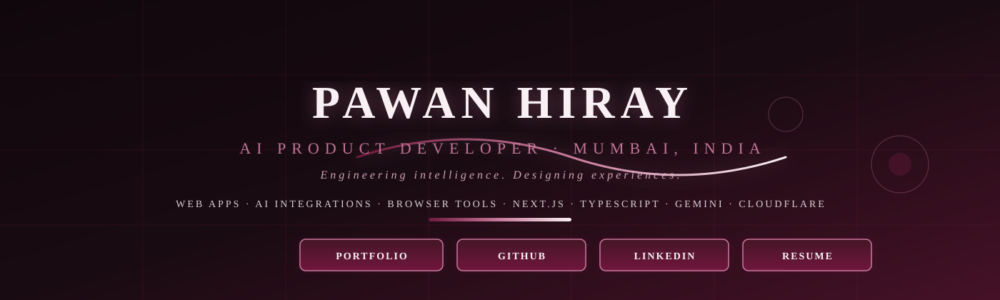

<!-- Pawan Hiray — GitHub Profile README -->
<!-- Verified info from https://github.com/hiraypawan and https://pawanhiray.vercel.app/ -->

  

<h1 align="center">Pawan Hiray</h1>

  <strong>AI Product Developer · Mumbai, India</strong>

  <a href="https://pawanhiray.vercel.app/">Portfolio</a> ·
  <a href="https://github.com/hiraypawan">GitHub</a> ·
  <a href="https://www.linkedin.com/in/pawan-hiray/">LinkedIn</a> ·
  <a href="https://pawanhiray.vercel.app/resume">Resume</a>

---

  

---

## 01 · About

  $ whoami 
  Pawan Hiray — AI Product Developer · Mumbai  
  $ cat focus.txt 
  Web apps · AI integrations · Browser tools 
  Next.js · TypeScript · Gemini · Cloudflare

Verified focus from portfolio and repositories:
- **AI Product Development** — voice-first workspaces, AI-assisted workflows (Gemini, OpenAI APIs)
- **Full-Stack Web** — Next.js, TypeScript, React, Node.js, MongoDB, PostgreSQL, Stripe, JWT
- **Browser Tools** — Chrome MV3 extensions, declarative APIs, web scraping
- **Community Platforms** — student notes systems, local civic platforms

---

## 02 · Recognition (Verified)

  <table style="border:none; background:#190B12; border-radius:12px; padding:20px;">
    <tr>
      <td style="text-align:center; padding:10px 20px;">
        <strong style="font-size:18px; color:#F8F0F3;">YOLO</strong> 
        GitHub Achievement
      </td>
      <td style="text-align:center; padding:10px 20px;">
        <strong style="font-size:18px; color:#F8F0F3;">Pull Shark</strong> 
        GitHub Achievement
      </td>
      <td style="text-align:center; padding:10px 20px;">
        <strong style="font-size:18px; color:#F8F0F3;">Pair Extraordinaire</strong> 
        GitHub Achievement
      </td>
    </tr>
  </table>

> Only verified public achievements shown. No unverified awards or statistics included.

---

## 03 · Selected Work

| # | Product | Stack | Description | Evidence |
|---|---|---|---|---|
| **01** | **OneBrain** | Next.js · TypeScript · Cloudflare Workers | Voice-first workspace for thoughts | <a href="https://github.com/hiraypawan/OneBrain">Code</a> · <a href="https://pawanhiray.vercel.app/work/onebrain">Case study</a> |
| **02** | **MUStudentsUnited** | React · Node.js · Express | Student notes + community platform | <a href="https://mumbaistudentsunited.com">Live</a> · <a href="https://pawanhiray.vercel.app/work/mustudentsunited">Case study</a> |
| **03** | **Smarty** | TypeScript · Chrome MV3 · Gemini AI | Browser extension for research tasks | <a href="https://github.com/hiraypawan/smarty">Repo</a> · <a href="https://pawanhiray.vercel.app/work/smarty">Case study</a> |

### More verified builds (from portfolio)

- **DigitalWorkForce** — marketplace for AI-assisted micro-work (Next.js · MongoDB · JWT · Stripe)
- **VibeCoder Pro** — browser coding workspace with Monaco editor + AI chat (Next.js · Cloudflare Workers)
- **PeoplePole** — map-based civic issue platform (React · Vite · Leaflet · Express · MongoDB)
- **Hand Cricket Pro** — cricket simulation with bot play and career mode (JavaScript · Cloudflare Pages)
- **SmartBotX** — Telegram AI bot using OpenAI API (Node.js · OpenAI API · Telegram API)
- **YtStop** — YouTube productivity Chrome extension (JavaScript · Chrome MV3)

*Project descriptions and implementations are owner-reported. No independently audited metrics are implied.*

---

## 04 · Skills (Verified from repos + portfolio)

  <table style="border-collapse:collapse; width:100%; max-width:700px; background:#190B12; border-radius:12px; overflow:hidden;">
    <tr style="background:#451126;">
      <th style="padding:12px; color:#F8F0F3; text-align:left;">Primary</th>
      <th style="padding:12px; color:#F8F0F3; text-align:left;">Where used</th>
    </tr>
    <tr>
      <td style="padding:10px; color:#F8F0F3;">TypeScript · JavaScript</td>
      <td style="padding:10px; color:#C77B9B;">OneBrain, Smarty, Portfolio, VibeCoder Pro</td>
    </tr>
    <tr>
      <td style="padding:10px; color:#F8F0F3;">Python</td>
      <td style="padding:10px; color:#C77B9B;">AI pipelines, data tasks</td>
    </tr>
    <tr>
      <td style="padding:10px; color:#F8F0F3;">Next.js · React · Node.js</td>
      <td style="padding:10px; color:#C77B9B;">Portfolio, DigitalWorkForce, PeoplePole</td>
    </tr>
    <tr>
      <td style="padding:10px; color:#F8F0F3;">Cloudflare (Workers / Pages)</td>
      <td style="padding:10px; color:#C77B9B;">OneBrain, Smarty, Hand Cricket Pro</td>
    </tr>
    <tr>
      <td style="padding:10px; color:#F8F0F3;">MongoDB · PostgreSQL · Stripe</td>
      <td style="padding:10px; color:#C77B9B;">DigitalWorkForce, PeoplePole</td>
    </tr>
  </table>

---

## 05 · Proof / Activity Map

> **Note:** This is a decorative illustration, not live GitHub contribution data. For live metrics, see the statistics card below.

---

## 06 · Statistics (Reliable Service)

---

## 07 · Verified Links & Evidence

- **Portfolio:** <https://pawanhiray.vercel.app/>
- **GitHub:** <https://github.com/hiraypawan>
- **LinkedIn:** <https://www.linkedin.com/in/pawan-hiray/>
- **Resume PDF:** <https://pawanhiray.vercel.app/resume>
- **Live Project:** MUStudentsUnited — <https://mumbaistudentsunited.com>
- **Selected Case Studies:** <https://pawanhiray.vercel.app/work>

---

## 08 · Footer

  
  
<em>Built with verified data only. No fabricated metrics. No private contact details.</em>

