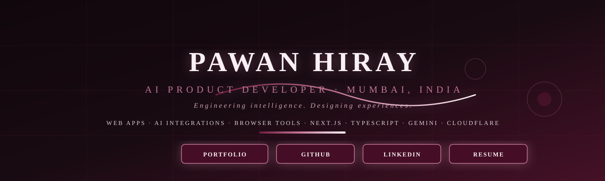
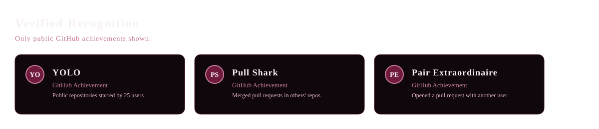

<!-- Pawan Hiray — GitHub Profile README -->
<!-- Verified info from https://github.com/hiraypawan and https://pawanhiray.vercel.app/ -->

<!-- Hero Portrait -->

  
  
  
  

<!-- About -->

  I design and build web apps, AI integrations, and browser tools with Next.js, TypeScript, and AI-assisted workflows. My focus: useful products, clear decisions, and work you can inspect.

<!-- Recognition -->

Only verified public achievements shown. No unverified awards or statistics included.

<!-- Selected Work -->

  <table style="border:none; border-radius:20px; overflow:hidden; background:#10070C; max-width:1000px; margin:0 auto 30px auto; border:1px solid #451126;">
    <tr>
      <td style="padding:40px 32px; vertical-align:top; width:55%; border-right:1px solid #190B12;">
        

          
AI · Voice · Workspace

          <h3 style="color:#F8F0F3; margin:0 0 14px 0; font-size:34px; line-height:1.1;">OneBrain</h3>
          
Voice-first workspace for capturing and reviewing thoughts.

          
BUILT &gt;&gt; Next.js · TypeScript · Cloudflare Workers

          

            Next.js
            TypeScript
            Cloudflare
          

          

            <a href="https://github.com/hiraypawan/OneBrain" style="background:#701A3D; color:#F8F0F3; text-decoration:none; padding:10px 20px; border-radius:8px; font-size:13px; font-weight:bold; border:1px solid #C77B9B; flex:1; text-align:center;">Repository</a>
            <a href="https://pawanhiray.vercel.app/work/onebrain" style="background:transparent; color:#C77B9B; text-decoration:none; padding:10px 20px; border-radius:8px; font-size:13px; font-weight:bold; border:1px solid #C77B9B; flex:1; text-align:center;">Case study</a>
          

        

      </td>
      <td style="padding:40px 32px; vertical-align:top; width:45%;">
        

          <svg viewBox="0 0 300 220" style="width:100%; height:100%; max-width:280px;" xmlns="http://www.w3.org/2000/svg">
            <rect width="300" height="220" fill="#10070C" rx="12" stroke="#451126" stroke-width="1"/>
            <text x="150" y="100" text-anchor="middle" fill="#C77B9B" font-size="14" letter-spacing="2" font-family="Georgia, serif">ONEBRAIN</text>
            <text x="150" y="120" text-anchor="middle" fill="#E5B5C7" font-size="12" font-family="Georgia, serif">voice-first workspace</text>
            <circle cx="90" cy="160" r="14" fill="none" stroke="#701A3D" stroke-width="2" opacity="0.6" />
            <circle cx="150" cy="160" r="10" fill="#C77B9B" />
            <circle cx="210" cy="160" r="14" fill="none" stroke="#701A3D" stroke-width="2" opacity="0.6" />
          </svg>
        

      </td>
    </tr>
  </table>

  <table style="border:none; border-radius:20px; overflow:hidden; background:#10070C; max-width:1000px; margin:0 auto 30px auto; border:1px solid #451126;">
    <tr>
      <td style="padding:40px 32px; vertical-align:top; width:55%; border-right:1px solid #190B12;">
        

          
Community · Full-stack

          <h3 style="color:#F8F0F3; margin:0 0 14px 0; font-size:34px; line-height:1.1;">MUStudentsUnited</h3>
          
Student notes + community platform for Mumbai University.

          
BUILT &gt;&gt; React · Node.js · Express

          

            React
            Node.js
            Express
          

          

            <a href="https://mumbaistudentsunited.com" style="background:#701A3D; color:#F8F0F3; text-decoration:none; padding:10px 20px; border-radius:8px; font-size:13px; font-weight:bold; border:1px solid #C77B9B; flex:1; text-align:center;">Live Site</a>
            <a href="https://pawanhiray.vercel.app/work/mustudentsunited" style="background:transparent; color:#C77B9B; text-decoration:none; padding:10px 20px; border-radius:8px; font-size:13px; font-weight:bold; border:1px solid #C77B9B; flex:1; text-align:center;">Case study</a>
          

        

      </td>
      <td style="padding:40px 32px; vertical-align:top; width:45%;">
        

          <svg viewBox="0 0 300 220" style="width:100%; height:100%; max-width:280px;" xmlns="http://www.w3.org/2000/svg">
            <rect width="300" height="220" fill="#10070C" rx="12" stroke="#451126" stroke-width="1"/>
            <text x="150" y="100" text-anchor="middle" fill="#C77B9B" font-size="14" letter-spacing="2" font-family="Georgia, serif">MUSTUDENTS</text>
            <text x="150" y="120" text-anchor="middle" fill="#E5B5C7" font-size="12" font-family="Georgia, serif">notes + community</text>
            <circle cx="90" cy="160" r="14" fill="none" stroke="#701A3D" stroke-width="2" opacity="0.6" />
            <circle cx="150" cy="160" r="10" fill="#C77B9B" />
            <circle cx="210" cy="160" r="14" fill="none" stroke="#701A3D" stroke-width="2" opacity="0.6" />
          </svg>
        

      </td>
    </tr>
  </table>

  <table style="border:none; border-radius:20px; overflow:hidden; background:#10070C; max-width:1000px; margin:0 auto; border:1px solid #451126;">
    <tr>
      <td style="padding:40px 32px; vertical-align:top; width:55%; border-right:1px solid #190B12;">
        

          
Browser · AI · Extension

          <h3 style="color:#F8F0F3; margin:0 0 14px 0; font-size:34px; line-height:1.1;">Smarty</h3>
          
Gemini-powered browser extension for repetitive research tasks.

          
BUILT &gt;&gt; TypeScript · Chrome MV3 · Gemini AI

          

            TypeScript
            Chrome MV3
            Gemini
          

          

            <a href="https://github.com/hiraypawan/smarty" style="background:#701A3D; color:#F8F0F3; text-decoration:none; padding:10px 20px; border-radius:8px; font-size:13px; font-weight:bold; border:1px solid #C77B9B; flex:1; text-align:center;">Repository</a>
            <a href="https://pawanhiray.vercel.app/work/smarty" style="background:transparent; color:#C77B9B; text-decoration:none; padding:10px 20px; border-radius:8px; font-size:13px; font-weight:bold; border:1px solid #C77B9B; flex:1; text-align:center;">Case study</a>
          

        

      </td>
      <td style="padding:40px 32px; vertical-align:top; width:45%;">
        

          <svg viewBox="0 0 300 220" style="width:100%; height:100%; max-width:280px;" xmlns="http://www.w3.org/2000/svg">
            <rect width="300" height="220" fill="#10070C" rx="12" stroke="#451126" stroke-width="1"/>
            <text x="150" y="100" text-anchor="middle" fill="#C77B9B" font-size="14" letter-spacing="2" font-family="Georgia, serif">SMARTY</text>
            <text x="150" y="120" text-anchor="middle" fill="#E5B5C7" font-size="12" font-family="Georgia, serif">gemini-powered extension</text>
            <circle cx="90" cy="160" r="14" fill="none" stroke="#701A3D" stroke-width="2" opacity="0.6" />
            <circle cx="150" cy="160" r="10" fill="#C77B9B" />
            <circle cx="210" cy="160" r="14" fill="none" stroke="#701A3D" stroke-width="2" opacity="0.6" />
          </svg>
        

      </td>
    </tr>
  </table>

Project descriptions and implementations are owner-reported. No independently audited metrics are implied.

<!-- Toolkit -->

  <table style="border-collapse:collapse; width:100%; max-width:700px; background:#190B12; border-radius:16px; overflow:hidden; border:1px solid #451126; margin:20px auto;">
    <tr style="background:#451126;">
      <th style="padding:14px; color:#F8F0F3; text-align:left; font-size:13px; letter-spacing:1px; text-transform:uppercase;">Primary</th>
      <th style="padding:14px; color:#F8F0F3; text-align:left; font-size:13px; letter-spacing:1px; text-transform:uppercase;">Where used</th>
    </tr>
    <tr>
      <td style="padding:12px; color:#F8F0F3;">TypeScript · JavaScript</td>
      <td style="padding:12px; color:#C77B9B;">OneBrain, Smarty, Portfolio, VibeCoder Pro</td>
    </tr>
    <tr style="background:#150C14;">
      <td style="padding:12px; color:#F8F0F3;">Python</td>
      <td style="padding:12px; color:#C77B9B;">AI pipelines, data tasks</td>
    </tr>
    <tr>
      <td style="padding:12px; color:#F8F0F3;">Next.js · React · Node.js</td>
      <td style="padding:12px; color:#C77B9B;">Portfolio, DigitalWorkForce, PeoplePole</td>
    </tr>
    <tr style="background:#150C14;">
      <td style="padding:12px; color:#F8F0F3;">Cloudflare (Workers / Pages)</td>
      <td style="padding:12px; color:#C77B9B;">OneBrain, Smarty, Hand Cricket Pro</td>
    </tr>
    <tr>
      <td style="padding:12px; color:#F8F0F3;">MongoDB · PostgreSQL · Stripe</td>
      <td style="padding:12px; color:#C77B9B;">DigitalWorkForce, PeoplePole</td>
    </tr>
  </table>

<!-- Commit Log (Live Contribution Graph) -->

  <strong>Live GitHub contribution graph</strong> — updates automatically from GitHub:

  This is GitHub's official live contribution graph. It updates in realtime as you push code.

  

<!-- Connect -->

  
  
  
  

<!-- Footer -->

